  

  

## ⟡ Profil

Développeur **PHP** passionné de **web services**, je relie les applications **IBM i (AS/400)** au web : API REST, échanges entre systèmes, interfaces modernes. Côté IBM i, je suis à l'aise en **CL** et sur les fichiers **PF / DDS** ; le RPG est en cours d'apprentissage. J'aime aussi automatiser et construire des outils avec l'IA.

  

## ⟡ Compétences

  
  
  
  

  

## ⟡ Quêtes en cours

| | Projet | Description |
|:-:|---|---|
| 🟦 | **Jarvis** | Assistant personnel de bureau sur Claude Code : voix, agenda, mails, supervision du PC |
| 🟪 | **IBM i ↔ web** | Applis PHP et web services branchés sur l'IBM i (DB2, CL) |
| 🟦 | **Automatisation** | Scripts et outils IA pour gagner du temps au quotidien |

## ⟡ Statistiques

  
  

  

  

Visuels animés créés pour ce profil, en hommage à l'univers de <i>Solo Leveling</i>.
